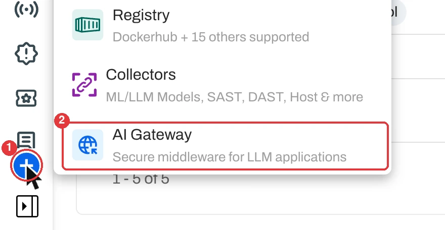
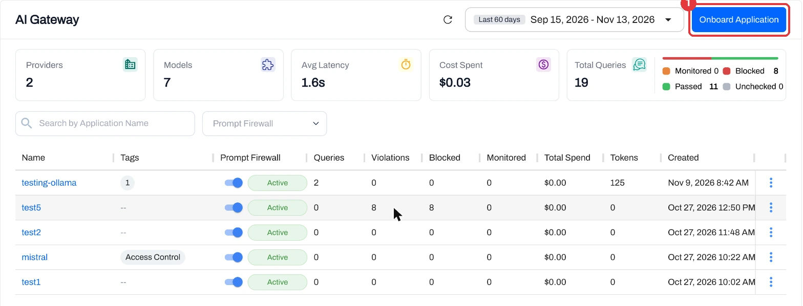
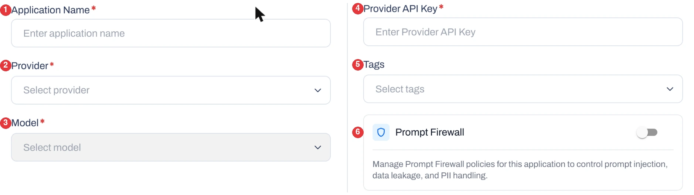
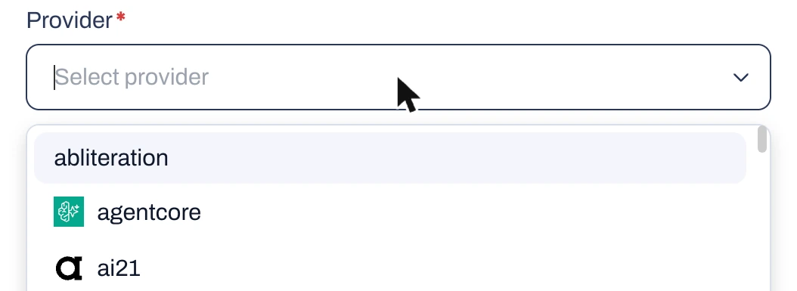
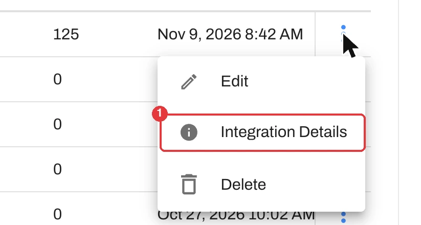
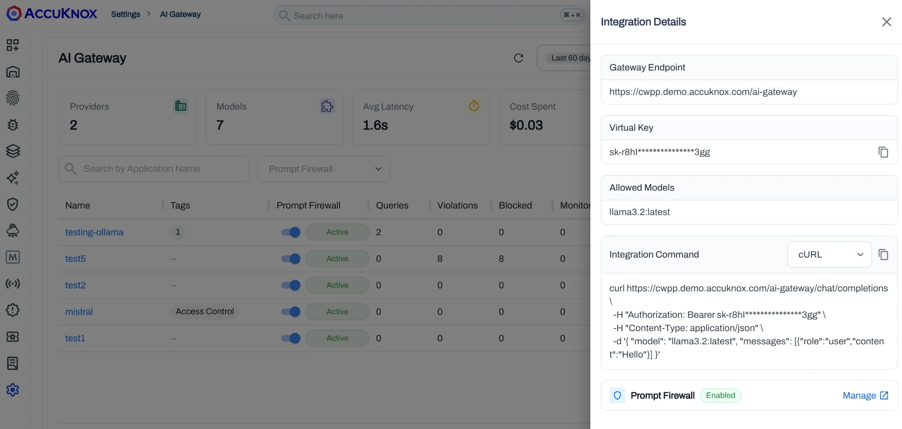
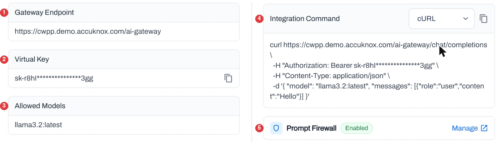
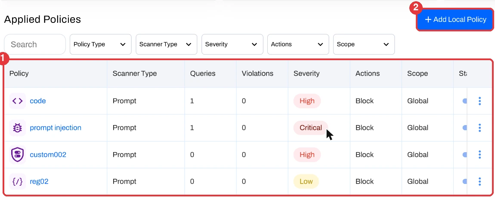

# Onboard with AI Gateway

Onboard an AI application in the AccuKnox console, then point your code at the gateway endpoint. This guide ends with your first monitored request.

!!! info "Before you start"
    Have these ready:

    - Access to your AccuKnox tenant.
    - The provider name and the model that your application uses.
    - A provider API key. For a self-hosted model such as Ollama, use the model endpoint instead.

## Open AI Gateway

1. Select the blue **+** button at the bottom of the left sidebar.
2. Select **AI Gateway**.



You can also go to **Settings > AI Gateway**. The page lists every onboarded application and its usage.

## Start Onboarding

Select **Onboard Application** at the top right of the AI Gateway page.



## Register the App

Fill in the **New Application** form.



1. **Application Name.** Enter a name that you can recognize in the dashboard. Required.
2. **Provider.** Pick your LLM provider from the list. Required.
3. **Model.** Pick the model that your application calls. The list loads after you pick a provider. Required.
4. **Provider API Key.** Enter your key for that provider. Required.
5. **Tags.** Add optional labels to group applications.
6. **Prompt Firewall.** Turn it on to scan prompts and responses for this application.



!!! tip "Self-hosted models"
    For a provider such as Ollama, the form also asks for a **Model Endpoint**. Enter the URL where your model runs.

Select **Test Connection** to check the details, then select **Save**.

## Copy Your Credentials

After you save, the application appears in the list.

1. Select the three-dot menu at the end of the application row.
2. Select **Integration Details**.



The **Integration Details** panel opens beside the application list. It has everything that your application needs.



Each section is numbered below.



1. **Gateway Endpoint.** Set this as the base URL in your application.
2. **Virtual Key.** Use it in place of the provider API key. Select the copy icon to copy it.
3. **Allowed Models.** Check which models this key can call.
4. **Integration Command.** Copy a ready-made example in cURL, Python, or Node.js.
5. **Prompt Firewall.** Check that the firewall is enabled. Select **Manage** to open its policies.

You now hold two values.

```text
Gateway Endpoint: <gateway-endpoint>
Virtual Key:      <virtual-key>
```

## Call the Gateway

Replace the provider URL and key with the gateway endpoint and your virtual key. Use a model from **Allowed Models**. No other change to your application logic is required.

=== "cURL"

    ```bash
    curl <gateway-endpoint>/chat/completions \
      -H "Authorization: Bearer <virtual-key>" \
      -H "Content-Type: application/json" \
      -d '{ "model": "<allowed-model>", "messages": [{"role":"user","content":"Hello"}] }'
    ```

=== "Python"

    ```python
    from openai import OpenAI

    client = OpenAI(
        api_key="<virtual-key>",
        base_url="<gateway-endpoint>"
    )

    response = client.chat.completions.create(
        model="<allowed-model>",
        messages=[{"role": "user", "content": "Explain Kubernetes"}]
    )
    print(response.choices[0].message.content)
    ```

=== "Node.js"

    ```javascript
    import OpenAI from "openai";

    const client = new OpenAI({
      apiKey: "<virtual-key>",
      baseURL: "<gateway-endpoint>"
    });

    const response = await client.chat.completions.create({
      model: "<allowed-model>",
      messages: [{ role: "user", content: "Explain Kubernetes" }]
    });
    console.log(response.choices[0].message.content);
    ```

!!! warning "Treat the virtual key like a secret"
    Store it in an environment variable or a secrets manager. Do not commit it to source control.

## Review Policies

When Prompt Firewall is on, the gateway scans each prompt and response against your policies.

1. In **Integration Details**, select **Manage** next to Prompt Firewall. The application's Prompt Firewall page opens in a new tab.
2. Review the **Applied Policies** table. It shows each policy, its severity, and its action, such as **Block**.
3. Select **Add Local Policy** to add a policy for this application only.



To create or tune policies, see [Prompt Firewall Setup](../how-to/prompt-firewall.md).

## Monitor Traffic

Send a test request, then return to **Settings > AI Gateway** and select the refresh icon. The page shows:

- **Total Queries** with the monitored, blocked, passed, and unchecked counts.
- **Providers**, **Models**, **Average Latency**, and **Cost Spent** for the date range.
- **Queries**, **Violations**, **Blocked**, **Monitored**, **Total Spend**, and **Tokens** for each application.

To see violations in detail, open **AI / ML Security > Prompt Firewall** and select the application.

## Edit or Remove

Use the three-dot menu on the application row.

- **Edit** changes the model, the model endpoint, the tags, and the Prompt Firewall toggle. Leave **Provider API Key** blank to keep the existing key.
- **Delete** removes the application from the gateway.

## Keep Exploring

<div class="ak-next">
  <a href="/getting-started/ai-gateway-overview/"><span class="ak-next-ico"><svg viewBox="0 0 24 24" aria-hidden="true"><path d="M12 3a9 9 0 100 18 9 9 0 000-18z"/><path d="M3 12h18"/><path d="M12 3c3 3 3 15 0 18"/><path d="M12 3c-3 3-3 15 0 18"/></svg></span><span class="ak-next-txt"><b>AI Gateway overview</b><small>How it works and why</small></span><span class="ak-next-go" aria-hidden="true">→</span></a>
  <a href="/use-cases/ai-gateway/"><span class="ak-next-ico"><svg viewBox="0 0 24 24" aria-hidden="true"><path d="M12 3l9 5-9 5-9-5 9-5z"/><path d="M3 13l9 5 9-5"/></svg></span><span class="ak-next-txt"><b>Use cases</b><small>Six ways teams use it</small></span><span class="ak-next-go" aria-hidden="true">→</span></a>
<a href="/how-to/aiml-overview/#onboard-an-ai-app"><span class="ak-next-ico"><svg viewBox="0 0 24 24" aria-hidden="true"><path d="M8 8l-4 4 4 4"/><path d="M16 8l4 4-4 4"/><path d="M13 6l-2 12"/></svg></span><span class="ak-next-txt"><b>Compare paths</b><small>Gateway, SDK or API</small></span><span class="ak-next-go" aria-hidden="true">→</span></a>
</div>
