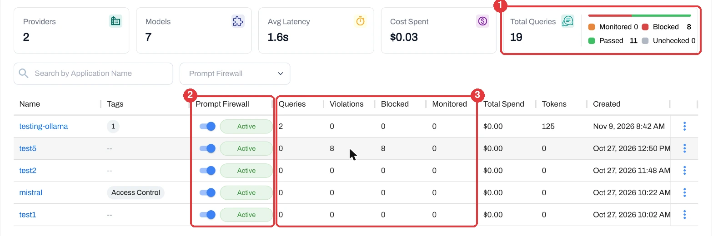

# AccuKnox AI Gateway

AccuKnox AI Gateway is a secure endpoint that sits between your AI application and the LLM. Your application calls the gateway instead of calling the model. The gateway checks each prompt, checks each response, and logs every request.

You change two values in your application: the base URL and the API key. You do not change your application logic.

## Where the Gateway Sits

<div class="ak-dia" role="img" aria-label="Architecture of AccuKnox AI Gateway. Your AI application sends prompts to the AI Gateway and receives sanitized responses. The gateway sends sanitized prompts to LLM providers such as vLLM, Ollama, OpenAI SDK, Claude Code and Azure Foundry, and receives their responses. The gateway sends each prompt and response to the AccuKnox Prompt Firewall, which has a traffic controller, policy governance and an audit log, and gets scan results back. The firewall sends reports to AccuKnox SaaS. You onboard applications in AccuKnox SaaS and receive an endpoint and a secret key.">
<svg viewBox="0 118 900 428" xmlns="http://www.w3.org/2000/svg">
  <defs>
    <marker id="agArrow" viewBox="0 0 10 10" refX="9" refY="5" markerWidth="7" markerHeight="7" orient="auto-start-reverse">
      <path d="M0,0 L10,5 L0,10 z" class="head-acc"/>
    </marker>
  </defs>

  <rect class="p2" x="20" y="190" width="190" height="110" rx="12"/>
  <circle class="plane" cx="115" cy="226" r="24"/><g class="ico" transform="translate(99.0,210.0) scale(1.33)"><path d="M3 5h18v14H3z"/><path d="M3 9h18"/><path d="M6.5 7h.01"/><path d="M9.5 7h.01"/></g>
  <text class="t-lg" x="115" y="278" text-anchor="middle">AI application</text>

  <rect class="plane" x="335" y="190" width="190" height="110" rx="12"/>
  <image href="/assets/images/logo-white.png" x="355" y="206" width="150" height="35" preserveAspectRatio="xMidYMid meet"/>
  <text class="t-plane t-xl" x="430" y="272" text-anchor="middle">AI Gateway</text>

  <path class="ln-acc w" d="M210 222 H335" marker-end="url(#agArrow)"/>
  <text class="t-md" x="272" y="212" text-anchor="middle">Prompt</text>
  <path class="ln-acc w" d="M335 268 H210" marker-end="url(#agArrow)"/>
  <text class="t-md" x="272" y="290" text-anchor="middle">Sanitized</text>
  <text class="t-md" x="272" y="308" text-anchor="middle">response</text>

  <rect class="p" x="650" y="130" width="230" height="300" rx="12"/>
  <text class="t-lg" x="765" y="162" text-anchor="middle">LLM providers</text>
  <rect x="668" y="180" width="32" height="32" rx="9" class="logo-tile"/><rect x="668" y="180" width="32" height="32" rx="9" class="plane"/><g class="ico" transform="translate(673.8,185.8) scale(0.85)"><path d="M4 4h16v6H4z"/><path d="M4 14h16v6H4z"/><path d="M8 7h.01"/><path d="M8 17h.01"/></g><text class="t-md" x="712" y="202" style="font-size:16px">vLLM</text>
  <rect x="668" y="222" width="32" height="32" rx="9" class="logo-tile"/><image href="/integrations/matrix-icons/ollama.svg" x="673.8" y="227.8" width="20.5" height="20.5" preserveAspectRatio="xMidYMid meet"/><text class="t-md" x="712" y="244" style="font-size:16px">Ollama</text>
  <rect x="668" y="264" width="32" height="32" rx="9" class="logo-tile"/><image href="/integrations/matrix-icons/openai.svg" x="673.8" y="269.8" width="20.5" height="20.5" preserveAspectRatio="xMidYMid meet"/><text class="t-md" x="712" y="286" style="font-size:16px">OpenAI SDK</text>
  <rect x="668" y="306" width="32" height="32" rx="9" class="logo-tile"/><image href="/integrations/matrix-icons/claudecode.svg" x="673.8" y="311.8" width="20.5" height="20.5" preserveAspectRatio="xMidYMid meet"/><text class="t-md" x="712" y="328" style="font-size:16px">Claude Code</text>
  <rect x="668" y="348" width="32" height="32" rx="9" class="logo-tile"/><image href="/integrations/matrix-icons/azure.svg" x="673.8" y="353.8" width="20.5" height="20.5" preserveAspectRatio="xMidYMid meet"/><text class="t-md" x="712" y="370" style="font-size:16px">Azure Foundry</text>
  <text class="t-sm" x="765" y="410" text-anchor="middle">and other frameworks</text>

  <path class="ln-acc w" d="M525 222 H650" marker-end="url(#agArrow)"/>
  <text class="t-md" x="588" y="196" text-anchor="middle">Sanitized</text>
  <text class="t-md" x="588" y="212" text-anchor="middle">prompt</text>
  <path class="ln-acc w" d="M650 268 H525" marker-end="url(#agArrow)"/>
  <text class="t-md" x="588" y="290" text-anchor="middle">Response</text>

  <path class="ln-acc w" d="M430 300 V380" marker-start="url(#agArrow)" marker-end="url(#agArrow)"/>
  <text class="t-md" x="446" y="334">Scan prompts</text>
  <text class="t-md" x="446" y="352">and responses</text>

  <rect class="p" x="270" y="380" width="320" height="156" rx="12"/>
  <circle class="plane" cx="296" cy="408" r="15"/><g class="ico" transform="translate(286.6,398.6) scale(0.78)"><path d="M12 3l7 3v5c0 5-3.5 8.5-7 10-3.5-1.5-7-5-7-10V6l7-3z"/><path d="M9 12l2 2 4-4"/></g>
  <text class="t-lg" x="320" y="414">Prompt Firewall</text>
  <circle class="plane" cx="296" cy="442" r="13"/><g class="ico" transform="translate(287.8,433.8) scale(0.68)"><path d="M7 7h13"/><path d="M16 3l4 4-4 4"/><path d="M17 17H4"/><path d="M8 13l-4 4 4 4"/></g><text class="t-md" x="320" y="447">Traffic controller (proxy)</text>
  <circle class="plane" cx="296" cy="472" r="13"/><g class="ico" transform="translate(287.8,463.8) scale(0.68)"><path d="M4 7h10"/><path d="M18 7h2"/><path d="M4 17h2"/><path d="M10 17h10"/><path d="M16 5v4"/><path d="M8 15v4"/></g><text class="t-md" x="320" y="477">Policy governance</text>
  <circle class="plane" cx="296" cy="502" r="13"/><g class="ico" transform="translate(287.8,493.8) scale(0.68)"><path d="M9 4h6v3H9z"/><path d="M7 5H5v16h14V5h-2"/><path d="M8 12h8"/><path d="M8 16h6"/></g><text class="t-md" x="320" y="507">Audit log of every request</text>

  <rect class="acc" x="20" y="380" width="190" height="156" rx="12"/>
  <rect x="36" y="398" width="158" height="44" rx="9" class="logo-tile"/>
  <image href="/assets/images/logo-black.png" x="46" y="406" width="138" height="28" preserveAspectRatio="xMidYMid meet"/>
  <text class="t-lg" x="115" y="478" text-anchor="middle">SaaS console</text>
  <text class="t-md" x="115" y="502" text-anchor="middle">and dashboard</text>
  <path class="ln-acc w" d="M115 380 V300" marker-start="url(#agArrow)" marker-end="url(#agArrow)"/>
  <text class="t-md" x="128" y="338">Onboard app</text>
  <text class="t-md" x="128" y="356">Endpoint and key</text>
  <path class="ln-acc w" d="M270 470 H210" marker-end="url(#agArrow)"/>
  <text class="t-md" x="240" y="460" text-anchor="middle">Reports</text>
</svg>
</div>

You register the application in AccuKnox SaaS and receive an endpoint and a secret key. Your application sends prompts to the gateway with that key. The gateway returns sanitized responses.

!!! info "AI Gateway adds a path. It does not replace Prompt Firewall."
    You can still onboard an application with the [SDK method](../how-to/llm-defense-app-onboard.md) or the [API method](../how-to/aiml-runtime-onboard.md). AI Gateway is the third option. Compare all three on the [AI Security overview](../how-to/aiml-overview.md#onboard-an-ai-app).

!!! note "Not the same as third-party gateway integrations"
    This page covers the AccuKnox AI Gateway. To connect a gateway you already run, see [Azure APIM](azure-ai-foundry.md), [AWS API Gateway](../how-to/aws-apim.md), [Apigee](../integrations/apigee-integration.md), [Bifrost](../integrations/bifrost-integration.md), or [LiteLLM](../integrations/litellm.md).

## How Requests Are Checked

Every prompt and every response passes through the Prompt Firewall. Your policy sets the outcome.

<div class="ak-dia" role="img" aria-label="The Prompt Firewall scans each prompt and response and applies one of three actions. Allow: the prompt goes to the LLM provider and the response returns sanitized. Block: the prompt is stopped before the LLM and the response is blocked, and the app is told. Monitor: the prompt is sent on and the response is returned, and the violation is logged.">
<svg viewBox="0 0 900 330" xmlns="http://www.w3.org/2000/svg">
<defs><marker id="agOutArrow" viewBox="0 0 10 10" refX="9" refY="5" markerWidth="7" markerHeight="7" orient="auto"><path d="M0,0 L10,5 L0,10 z" class="head-acc"/></marker></defs>
<rect class="plane" x="250" y="8" width="400" height="62" rx="12"/>
<g class="ico" transform="translate(281.6,24.6) scale(1.2)"><path d="M12 3l7 3v5c0 5-3.5 8.5-7 10-3.5-1.5-7-5-7-10V6l7-3z"/><path d="M9 12l2 2 4-4"/></g>
<text class="t-plane t-xl" x="326" y="46" style="font-size:20px">Firewall scans each request</text>
<path class="ln-acc w" d="M450 70 V92"/>
<path class="ln-acc w" d="M150 92 H750"/>
<path class="ln-acc w" d="M150 92 V116" marker-end="url(#agOutArrow)"/>
<path class="ln-acc w" d="M450 92 V116" marker-end="url(#agOutArrow)"/>
<path class="ln-acc w" d="M750 92 V116" marker-end="url(#agOutArrow)"/>
<rect class="good" x="10" y="116" width="280" height="204" rx="12"/>
<circle cx="56" cy="162" r="26" style="fill:var(--ak-ok)"/>
<g class="ico" transform="translate(40.0,146.0) scale(1.33)"><path d="M5 12l5 5 9-10"/></g>
<text class="t-xl" x="98" y="170">Allow</text>
<text class="t-sm" x="32" y="220" style="letter-spacing:.1em">PROMPT</text>
<text class="t-md" x="32" y="244" style="font-size:16px">Goes to the LLM provider</text>
<text class="t-sm" x="32" y="276" style="letter-spacing:.1em">RESPONSE</text>
<text class="t-md" x="32" y="300" style="font-size:16px">Returned, sanitized</text>
<rect class="bad" x="310" y="116" width="280" height="204" rx="12"/>
<circle cx="356" cy="162" r="26" style="fill:var(--ak-danger)"/>
<g class="ico" transform="translate(340.0,146.0) scale(1.33)"><path d="M12 3a9 9 0 100 18 9 9 0 000-18z"/><path d="M5.6 5.6l12.8 12.8"/></g>
<text class="t-xl" x="398" y="170">Block</text>
<text class="t-sm" x="332" y="220" style="letter-spacing:.1em">PROMPT</text>
<text class="t-md" x="332" y="244" style="font-size:16px">Stopped before the LLM</text>
<text class="t-sm" x="332" y="276" style="letter-spacing:.1em">RESPONSE</text>
<text class="t-md" x="332" y="300" style="font-size:16px">Blocked, app is told</text>
<rect class="acc" x="610" y="116" width="280" height="204" rx="12"/>
<circle cx="656" cy="162" r="26" style="fill:var(--ak-accent)"/>
<g class="ico" transform="translate(640.0,146.0) scale(1.33)"><path d="M2 12s4-7 10-7 10 7 10 7-4 7-10 7S2 12 2 12z"/><path d="M12 9a3 3 0 100 6 3 3 0 000-6z"/></g>
<text class="t-xl" x="698" y="170">Monitor</text>
<text class="t-sm" x="632" y="220" style="letter-spacing:.1em">PROMPT</text>
<text class="t-md" x="632" y="244" style="font-size:16px">Sent on, violation logged</text>
<text class="t-sm" x="632" y="276" style="letter-spacing:.1em">RESPONSE</text>
<text class="t-md" x="632" y="300" style="font-size:16px">Returned, violation logged</text>
</svg></div>

The firewall scans prompts for prompt injection, jailbreaks, secrets, and sensitive data. It scans responses for unsafe content, malicious output, and data leaks.

## Why Teams Use It

- **No application rewrite.** Point your OpenAI-compatible client at the gateway endpoint. Your prompts and parsing code stay the same.
- **One entry point for many models.** Onboard OpenAI, Anthropic, Amazon Nova, Ollama, and more behind one gateway.
- **Provider keys stay with AccuKnox.** Your application holds a virtual key. You enter the real provider key once, in the AccuKnox console.
- **Model control per application.** Each application has a list of allowed models, shown in its integration details.
- **Security in the same form.** Turn on Prompt Firewall in the form that you use to onboard the application.
- **Usage you can read.** The dashboard shows queries, blocked and passed counts, average latency, tokens, and spend.



## What Changes in Your Code

Only the API key and the base URL change. The rest of your code stays the same.

```python
from openai import OpenAI

client = OpenAI(
    api_key="<virtual-key>",         # was: your provider API key
    base_url="<gateway-endpoint>"    # was: the provider URL
)

response = client.chat.completions.create(
    model="gpt-4",
    messages=[
        {"role": "user", "content": "Explain Kubernetes"}
    ]
)

print(response.choices[0].message.content)
```

Copy your own endpoint and virtual key from **Integration Details**. See [Onboard an application with AI Gateway](ai-gateway-onboarding.md).

## Works With Many Providers

The provider list in the onboarding form is long. It includes Anthropic, Amazon Nova, AI21, Anyscale, and Ollama.

- **Cloud providers.** Select the provider, pick a model, and enter your provider API key.
- **Self-hosted models.** For frameworks such as Ollama, enter the model endpoint. AI Gateway also supports vLLM, Azure Foundry, and NVIDIA Triton.

## Start Onboarding

<div class="ak-next">
  <a href="/getting-started/ai-gateway-onboarding/"><span class="ak-next-ico"><svg viewBox="0 0 24 24" aria-hidden="true"><path d="M3 5h18v14H3z"/><path d="M3 9h18"/><path d="M6.5 7h.01"/><path d="M9.5 7h.01"/></svg></span><span class="ak-next-txt"><b>Onboard an app</b><small>Register it in the console</small></span><span class="ak-next-go" aria-hidden="true">→</span></a>
  <a href="/use-cases/ai-gateway/"><span class="ak-next-ico"><svg viewBox="0 0 24 24" aria-hidden="true"><path d="M12 3l9 5-9 5-9-5 9-5z"/><path d="M3 13l9 5 9-5"/></svg></span><span class="ak-next-txt"><b>See the use cases</b><small>Six ways teams use it</small></span><span class="ak-next-go" aria-hidden="true">→</span></a>
  <a href="/use-cases/prompt-firewall-overview/"><span class="ak-next-ico"><svg viewBox="0 0 24 24" aria-hidden="true"><path d="M12 3l7 3v5c0 5-3.5 8.5-7 10-3.5-1.5-7-5-7-10V6l7-3z"/><path d="M9 12l2 2 4-4"/></svg></span><span class="ak-next-txt"><b>Prompt Firewall policies</b><small>Tune what gets blocked</small></span><span class="ak-next-go" aria-hidden="true">→</span></a>
</div>
