# Prompt Firewall for Microsoft Copilot Studio

AgentZ checks every tool call a Microsoft Copilot Studio agent makes, before the tool runs. Copilot Studio sends the conversation and the tool call to AgentZ. AgentZ runs your Prompt Firewall guardrails and answers allow or block. A blocked call never reaches the tool, and the user sees that the action was blocked.

<iframe width="560" height="315" src="https://www.youtube.com/embed/LmMvT-rI_Dk" title="Prompt Firewall for Copilot Studio Agents With AgentZ" frameborder="0" allowfullscreen></iframe>

## AgentZ Answers Before the Tool Runs

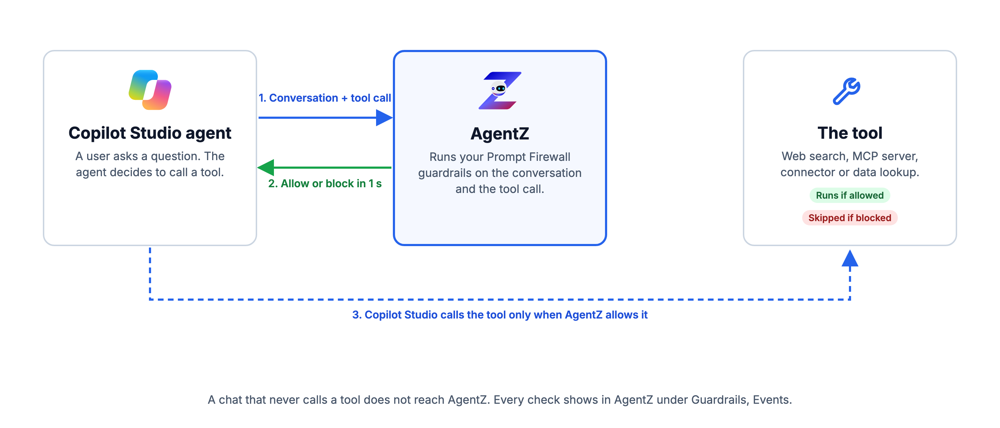

A tool call is anything the agent does beyond its own reasoning: a web search, an MCP server, a connector, a skill or a data lookup. AgentZ sees the whole conversation at the moment of the call, so a guardrail can judge the request in context. Every check shows in AgentZ under **Guardrails**, then **Events**, and the full conversation shows under **Traces**.

## Prerequisites

- An AgentZ account at [agentzharness.ai](https://agentzharness.ai/).
- The Azure CLI on the machine you run the commands from.
- An Azure admin with two roles: Cloud Application Administrator and Power Platform Administrator.
- A Copilot Studio environment with at least one agent.

## Connect Copilot Studio in 10 Steps

Start in AgentZ. Go to **External agents** > **Add external agent** > **Microsoft Copilot Studio**. The panel lists every command below with your values filled in. Copy the commands from the panel.

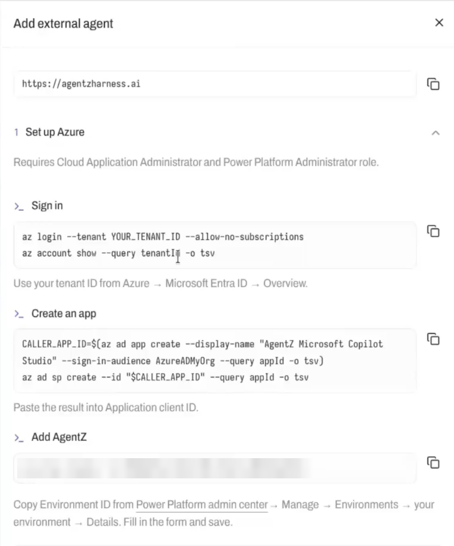

### Step 1: Sign In to Azure

Run the sign-in commands. Paste the tenant ID they print into **Directory tenant ID**.

```bash
az login --tenant YOUR_TENANT_ID --allow-no-subscriptions
az account show --query tenantId -o tsv
```

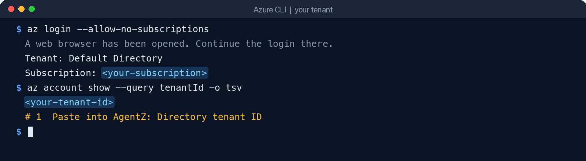

### Step 2: Create the Entra App

Run the command to create one Entra app for your organization. Paste the ID it returns into **Application client ID**.

```bash
CALLER_APP_ID=$(az ad app create --display-name "AgentZ Microsoft Copilot Studio" --sign-in-audience AzureADMyOrg --query appId -o tsv)
az ad sp create --id "$CALLER_APP_ID" --query appId -o tsv
```

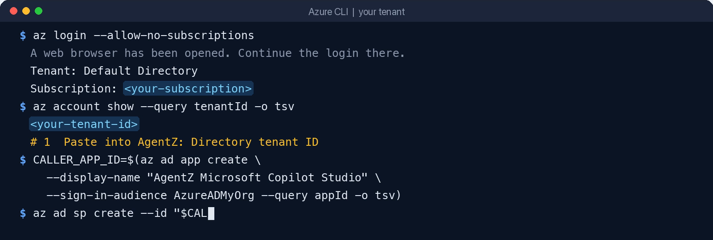

### Step 3: Register the AgentZ App

Copy the command from the **Add AgentZ** box in the panel. It carries the AgentZ application ID. Run it.

```bash
az ad sp create --id <AgentZ application ID from the panel>
```

A message that the service principal already exists is fine. The app is registered.

### Step 4: Copy the Environment ID

1. Open the Power Platform admin center.
2. Go to **Manage** > **Environments** and pick your environment.
3. Copy the environment ID into **Power Platform environment ID** in AgentZ.

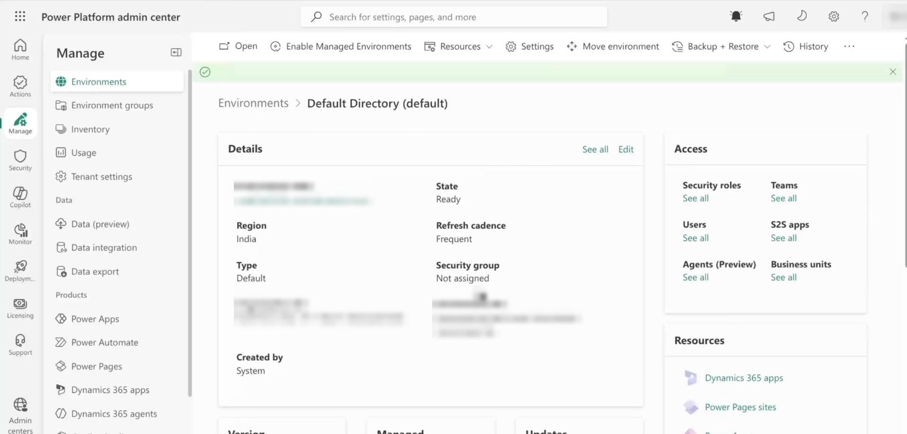

### Step 5: Add the Connection

Check that the three IDs are filled in. Click **Add connection**.

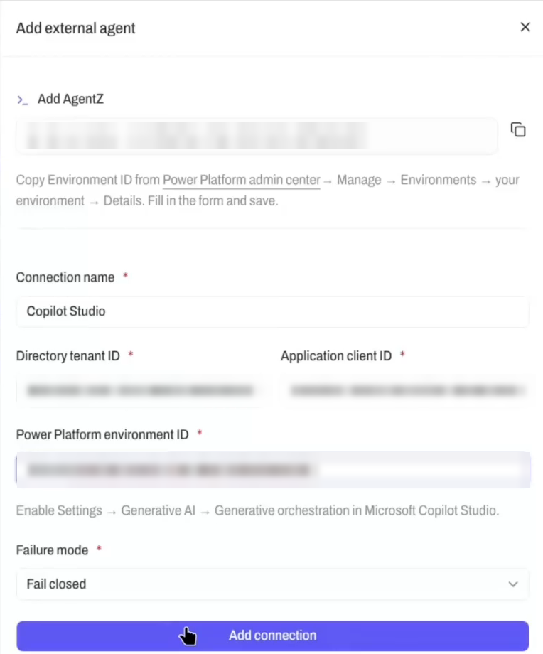

### Step 6: Add the Federated Credential

Run the credential command that AgentZ shows next. Copilot Studio then signs in as your app with a token from Microsoft. You store no client secret.

```bash
az ad app federated-credential create --id <your application client ID> --parameters '{
  "name": "<name from the panel>",
  "issuer": "https://login.microsoftonline.com/<your tenant ID>/v2.0",
  "subject": "<subject from the panel>",
  "audiences": ["api://AzureADTokenExchange"]
}'
```

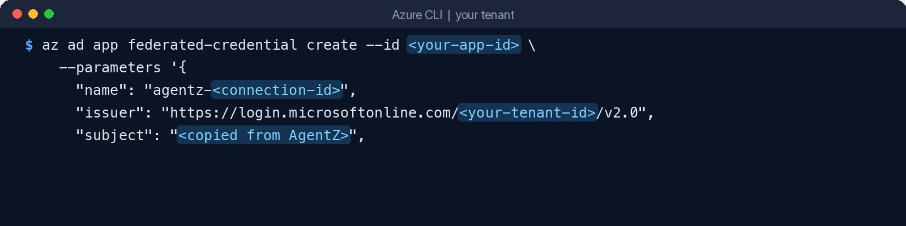

### Step 7: Turn On Threat Detection

1. In the Power Platform admin center, go to **Security** > **Threat detection**.
2. Open **Additional threat detection and protection for Copilot Studio agents**.

    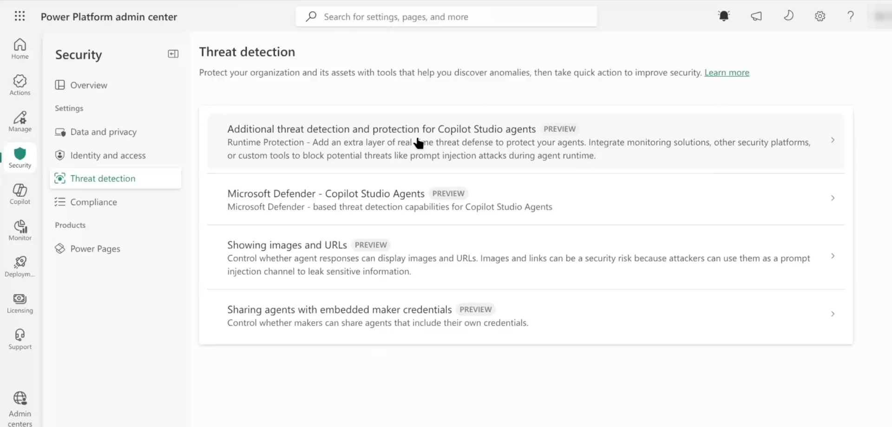

3. Pick your environment and click **Set up**.
4. Turn on data sharing with a threat detection partner.
5. Paste the Azure Entra App ID and the endpoint link from AgentZ.
6. Set the error behavior to **Block the query** and click **Save**.

    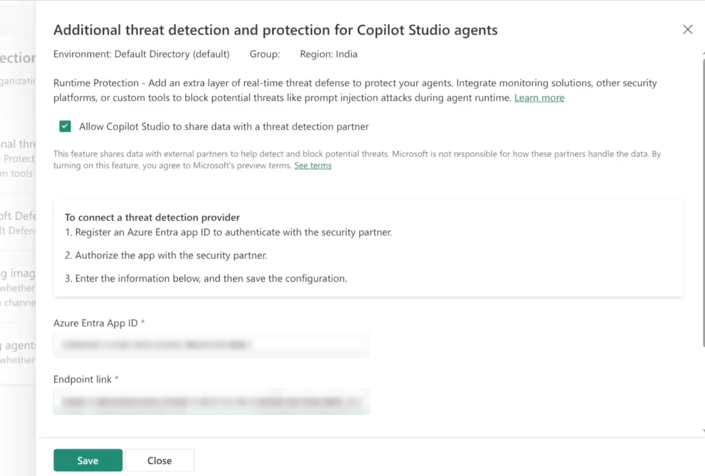

AgentZ shows **Validated by Microsoft** when the link works.

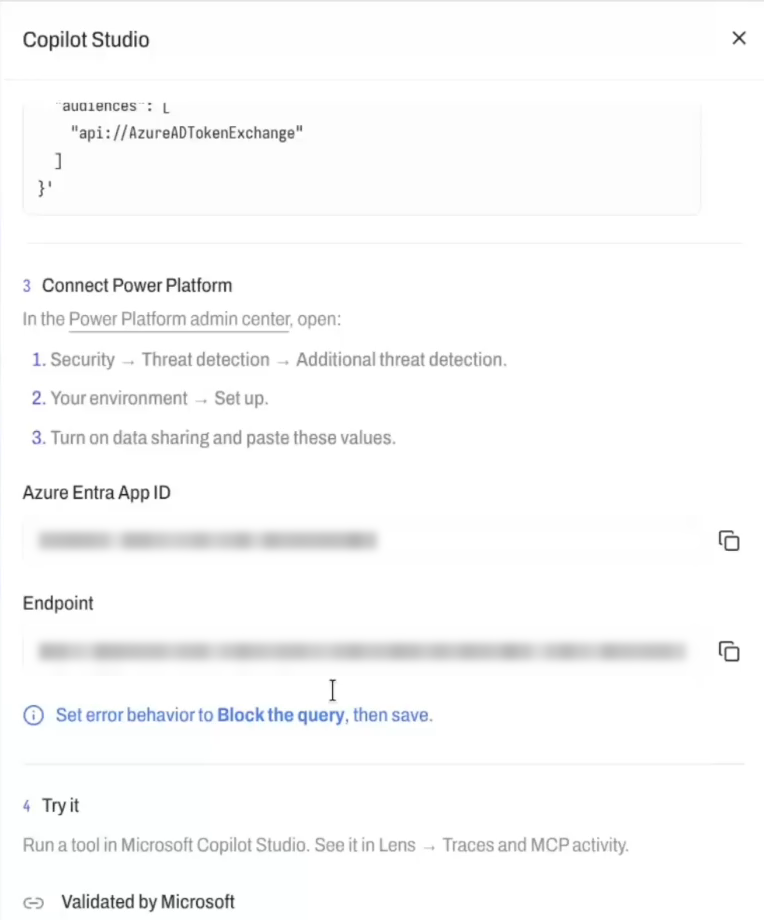

### Step 8: Add a Guardrail

1. In AgentZ, open the Copilot Studio connection and go to **Policies**.
2. Add a check. For a first test, block phone numbers with a regular expression.

    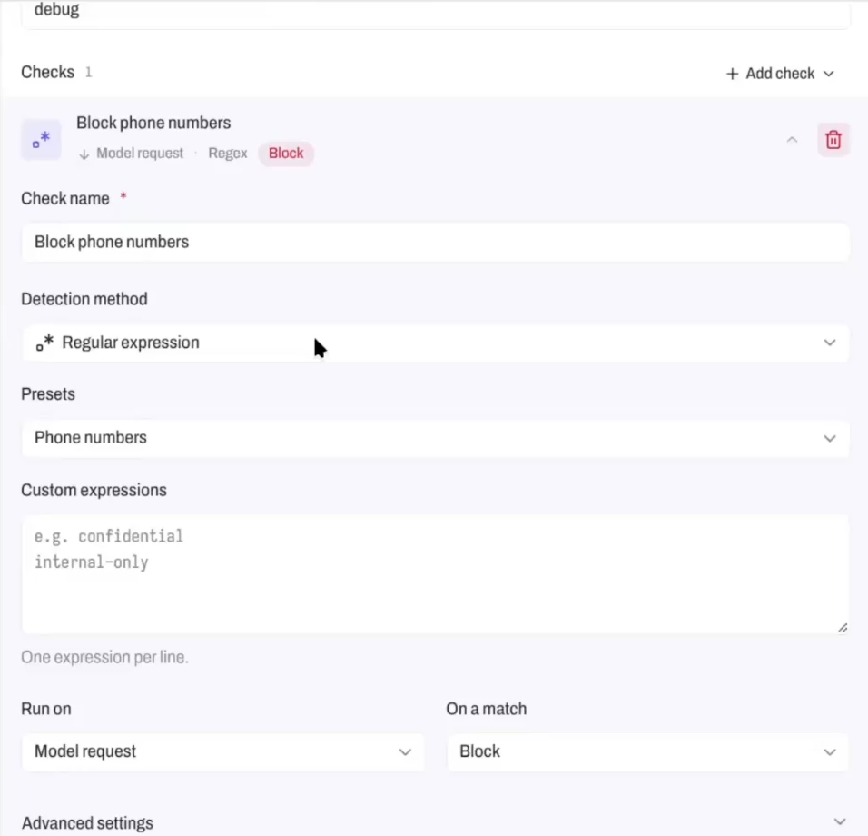

3. Pick the policy for the agent and click **Save guardrails**.

    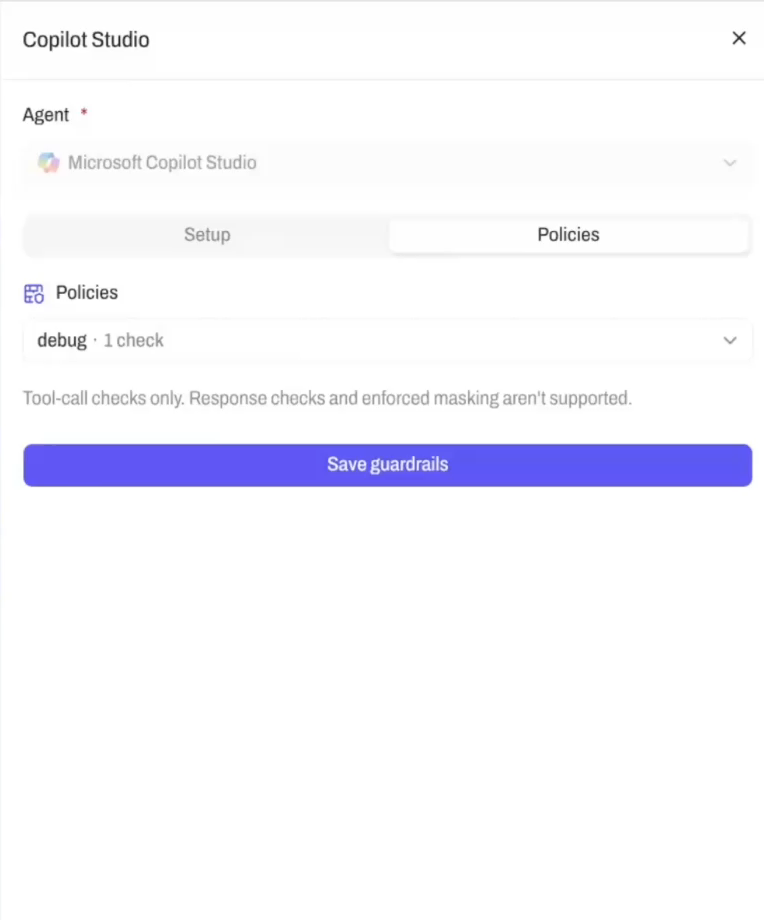

### Step 9: Test the Agent

In Copilot Studio, ask the agent to search the web for a phone number, such as `+91 9999999999`. The reply says the action was blocked by threat detection tools.

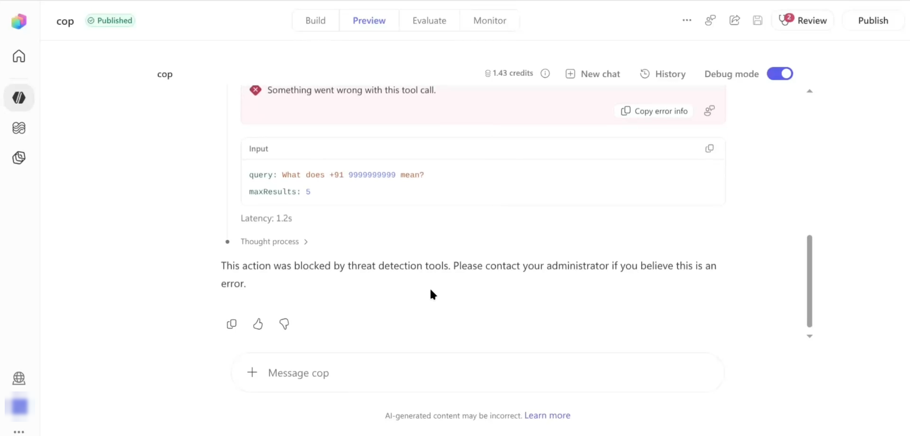

### Step 10: See the Block in AgentZ

In AgentZ, go to **Guardrails** > **Events**. The blocked call is at the top, with the check that fired.

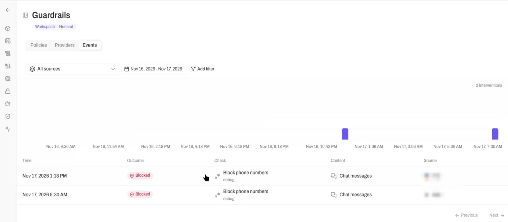

## Five Caveats to Know Before You Roll Out

- **Only tool calls are checked.** A chat that never calls a tool does not reach AgentZ, so a guardrail on plain chat text never fires. A phone number typed into a chat that needs no tool passes through.
- **AgentZ must answer within one second.** Microsoft sets this limit. With **Block the query**, Copilot Studio blocks any call that AgentZ cannot check in time. A regular expression check answers fastest. A check that calls a model can take longer.
- **Each environment needs its own connection.** The Power Platform step runs in the admin center only, with no API, so connect each environment by hand.
- **Every agent in a connected environment is covered.** You cannot pick some agents in an environment and leave others out.
- **The Microsoft feature is in preview.** The Power Platform screens and labels can change.
