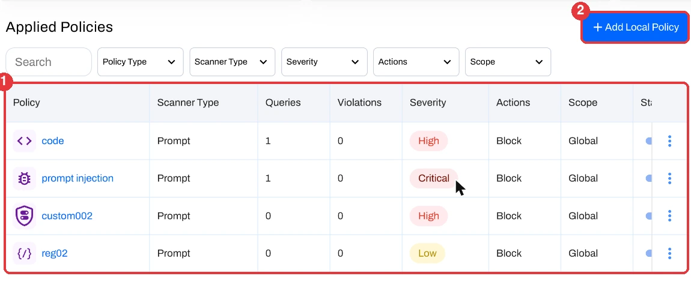
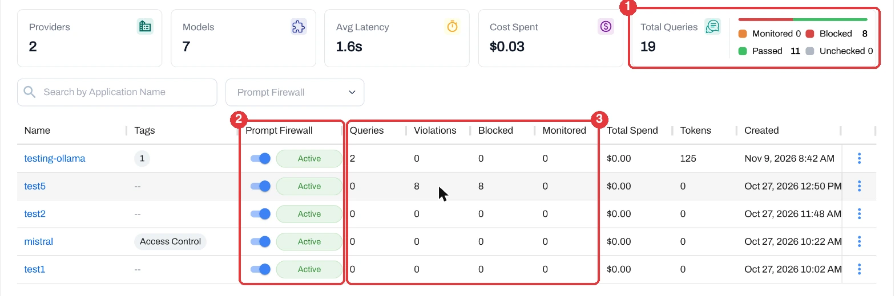

# AI Gateway Use Cases

AccuKnox AI Gateway gives every AI application one secure endpoint. These six use cases show where that helps most. For the concept, see the [AI Gateway overview](../getting-started/ai-gateway-overview.md). To set it up, see [Onboard an application with AI Gateway](../getting-started/ai-gateway-onboarding.md).

<svg viewBox="0 28 900 532" xmlns="http://www.w3.org/2000/svg">
<path class="ln-acc w" d="M150 214 V262"/>
<path class="ln-acc w" d="M450 214 V262"/>
<path class="ln-acc w" d="M750 214 V262"/>
<path class="ln-acc w" d="M150 338 V386"/>
<path class="ln-acc w" d="M450 338 V386"/>
<path class="ln-acc w" d="M750 338 V386"/>
<rect class="plane" x="15" y="252" width="870" height="96" rx="48"/>
<image href="/assets/images/logo-white.png" x="262" y="268" width="170" height="40" preserveAspectRatio="xMidYMid meet"/>
<text class="t-plane t-xl" x="442" y="297">AI Gateway</text>
<text class="t-pill t-md" x="450" y="328" text-anchor="middle">One secure endpoint for every AI application</text>
<text class="t-pill t-md" x="56" y="306" style="letter-spacing:.08em">↑ PROTECT</text>
<text class="t-pill t-md" x="844" y="306" text-anchor="end" style="letter-spacing:.08em">CONTROL AND PROVE ↓</text>
<rect class="p" x="15" y="44" width="270" height="170" rx="12"/>
<circle class="plane" cx="61" cy="94" r="26"/><g class="ico" transform="translate(45.0,78.0) scale(1.33)"><path d="M12 3l7 3v5c0 5-3.5 8.5-7 10-3.5-1.5-7-5-7-10V6l7-3z"/><path d="M9 12l2 2 4-4"/></g>
<text class="t-lg" x="39" y="156">Secure an LLM app</text>
<text class="t-md" x="39" y="180">Swap the base URL.</text>
<text class="t-md" x="39" y="200">Keep your code.</text>
<rect class="p" x="315" y="44" width="270" height="170" rx="12"/>
<circle class="plane" cx="361" cy="94" r="26"/><g class="ico" transform="translate(345.0,78.0) scale(1.33)"><path d="M4 4h16v6H4z"/><path d="M4 14h16v6H4z"/><path d="M8 7h.01"/><path d="M8 17h.01"/></g>
<rect x="415" y="76" width="36" height="36" rx="9" class="logo-tile"/><image href="/integrations/matrix-icons/ollama.svg" x="421.5" y="82.5" width="23.0" height="23.0" preserveAspectRatio="xMidYMid meet"/>
<rect x="463" y="76" width="36" height="36" rx="9" class="logo-tile"/><rect x="463" y="76" width="36" height="36" rx="9" class="plane"/><g class="ico" transform="translate(470.8,83.8) scale(0.85)"><path d="M4 4h16v6H4z"/><path d="M4 14h16v6H4z"/><path d="M8 7h.01"/><path d="M8 17h.01"/></g>
<rect x="511" y="76" width="36" height="36" rx="9" class="logo-tile"/><image href="/integrations/matrix-icons/nvidia.svg" x="517.5" y="82.5" width="23.0" height="23.0" preserveAspectRatio="xMidYMid meet"/>
<text class="t-lg" x="339" y="156">Self-hosted models</text>
<text class="t-md" x="339" y="180">Ollama, vLLM and</text>
<text class="t-md" x="339" y="200">NVIDIA Triton.</text>
<rect class="p" x="615" y="44" width="270" height="170" rx="12"/>
<circle class="plane" cx="661" cy="94" r="26"/><g class="ico" transform="translate(645.0,78.0) scale(1.33)"><path d="M8 8l-4 4 4 4"/><path d="M16 8l4 4-4 4"/><path d="M13 6l-2 12"/></g>
<rect x="715" y="76" width="36" height="36" rx="9" class="logo-tile"/><image href="/integrations/matrix-icons/claudecode.svg" x="721.5" y="82.5" width="23.0" height="23.0" preserveAspectRatio="xMidYMid meet"/>
<text class="t-lg" x="639" y="156">Developer tools</text>
<text class="t-md" x="639" y="180">Tools such as</text>
<text class="t-md" x="639" y="200">Claude Code.</text>
<rect class="p" x="15" y="386" width="270" height="170" rx="12"/>
<circle class="plane" cx="61" cy="436" r="26"/><g class="ico" transform="translate(45.0,420.0) scale(1.33)"><path d="M12 3l9 5-9 5-9-5 9-5z"/><path d="M3 13l9 5 9-5"/></g>
<rect x="115" y="418" width="36" height="36" rx="9" class="logo-tile"/><image href="/integrations/matrix-icons/openai.svg" x="121.5" y="424.5" width="23.0" height="23.0" preserveAspectRatio="xMidYMid meet"/>
<rect x="163" y="418" width="36" height="36" rx="9" class="logo-tile"/><image href="/integrations/matrix-icons/anthropic.svg" x="169.5" y="424.5" width="23.0" height="23.0" preserveAspectRatio="xMidYMid meet"/>
<rect x="211" y="418" width="36" height="36" rx="9" class="logo-tile"/><image href="/integrations/matrix-icons/azure.svg" x="217.5" y="424.5" width="23.0" height="23.0" preserveAspectRatio="xMidYMid meet"/>
<text class="t-lg" x="39" y="498">Many providers</text>
<text class="t-md" x="39" y="522">One endpoint for</text>
<text class="t-md" x="39" y="542">every model.</text>
<rect class="p" x="315" y="386" width="270" height="170" rx="12"/>
<circle class="plane" cx="361" cy="436" r="26"/><g class="ico" transform="translate(345.0,420.0) scale(1.33)"><path d="M4 20V10"/><path d="M10 20V4"/><path d="M16 20v-8"/><path d="M22 20H2"/></g>
<text class="t-lg" x="339" y="498">Usage and cost</text>
<text class="t-md" x="339" y="522">Latency, tokens and</text>
<text class="t-md" x="339" y="542">spend for every app.</text>
<rect class="p" x="615" y="386" width="270" height="170" rx="12"/>
<circle class="plane" cx="661" cy="436" r="26"/><g class="ico" transform="translate(645.0,420.0) scale(1.33)"><path d="M9 4h6v3H9z"/><path d="M7 5H5v16h14V5h-2"/><path d="M8 12h8"/><path d="M8 16h6"/></g>
<text class="t-lg" x="639" y="498">Audit trail</text>
<text class="t-md" x="639" y="522">Prompt logs and</text>
<text class="t-md" x="639" y="542">violation reports.</text>
</svg>

## Secure an LLM App

**Situation.** A team ships a chatbot that calls an LLM. Security wants protection against prompt injection and data leaks before launch. The team cannot add a new SDK this sprint.

**How AI Gateway helps.**

1. Onboard the application and turn on **Prompt Firewall**.
2. Copy the **Gateway Endpoint** and **Virtual Key** from **Integration Details**.
3. Replace the base URL and API key in the application.

The gateway now scans each prompt and each response. Policies such as prompt injection and code detection run with the action that you set, for example **Block**.

## Unify Many Providers

**Situation.** Different teams use different providers. Each team keeps its own key and its own client code. Nobody has one view of what runs where.

**How AI Gateway helps.**

- Onboard each application with its provider and model. The list includes Anthropic, Amazon Nova, AI21, and more.
- Give each application its own virtual key.
- Review all applications in one table at **Settings > AI Gateway**.

Your teams keep their provider of choice. You keep one control point.

## Protect Self-Hosted Models

**Situation.** A team runs a model on its own infrastructure with Ollama, vLLM, or NVIDIA Triton. The model has no built-in prompt checks.

**How AI Gateway helps.**

1. Select the provider, for example **Ollama**.
2. Enter the model name and the **Model Endpoint** where your model runs.
3. Turn on **Prompt Firewall**.

Applications call the gateway. The gateway applies your policies, then forwards safe requests to your endpoint.

## Track Usage and Cost

**Situation.** Finance wants to know which application drives LLM spend. Engineering wants to know which one is slow.

**How AI Gateway helps.** The AI Gateway page reports these values for the selected date range.

- Totals for **Providers**, **Models**, **Average Latency**, and **Cost Spent**.
- A **Total Queries** card that splits traffic into passed, blocked, monitored, and unchecked.
- For each application: **Queries**, **Violations**, **Blocked**, **Monitored**, **Total Spend**, and **Tokens**.

## Govern Developer Tools

**Situation.** Developers use tools such as Claude Code that call an LLM from their machines. Security needs the same checks that apply to production apps.

**How AI Gateway helps.** Onboard the tool as an application. Tools that let you set a custom base URL and API key can send traffic through the gateway. The firewall then scans prompts for secrets and sensitive data before they reach the model.

!!! note "Tool support"
    Claude Code is one of the integrations that AI Gateway supports. Check your tool for a setting to override the API base URL.

## Keep an Audit Trail

**Situation.** An auditor asks who sent what to which model, and what the controls did about it.

**How AI Gateway helps.** Every request through the gateway is logged. You can review:

- Prompt and response logs.
- Violation reports and policy enforcement results.
- Application usage metrics and model usage.

To dig into a violation, open **AI / ML Security > Prompt Firewall**, select the application, and use **Go To Issues**.

## Choose a Path

AI Gateway is one of three ways to onboard an AI application. Follow the branch that matches your situation. Select a guide to open it.

<svg viewBox="0 0 900 400" xmlns="http://www.w3.org/2000/svg">
<defs><marker id="agChooseArrow" viewBox="0 0 10 10" refX="9" refY="5" markerWidth="7" markerHeight="7" orient="auto"><path d="M0,0 L10,5 L0,10 z" class="head-acc"/></marker></defs>
<path class="ln-acc w" d="M180 200 C205 200 205 70 230 70"/>
<path class="ln-acc w" d="M180 200 C205 200 205 200 230 200"/>
<path class="ln-acc w" d="M180 200 C205 200 205 330 230 330"/>
<rect class="plane" x="10" y="10" width="170" height="380" rx="12"/>
<text class="t-plane t-xl" x="95" y="186" text-anchor="middle">Onboard</text>
<text class="t-plane t-xl" x="95" y="214" text-anchor="middle">an AI app</text>
<text class="t-pill t-md" x="95" y="250" text-anchor="middle">Which path fits?</text>
<rect class="p" x="230" y="10" width="430" height="120" rx="12"/>
<text class="t-acc t-md fw7 caps" x="252" y="44">IF</text>
<text class="t-md" x="252" y="76" style="font-size:17px">The app uses an OpenAI-compatible client.</text>
<text class="t-md" x="252" y="104" style="font-size:17px">You want to change only the URL and key.</text>
<path class="ln-acc w" d="M660 70 H700" marker-end="url(#agChooseArrow)"/>
<a href="/getting-started/ai-gateway-onboarding/"><rect class="acc" x="700" y="10" width="190" height="120" rx="12"/>
<text class="t-acc t-md fw7 caps" x="722" y="44">USE</text>
<text class="t-xl" x="722" y="82">AI Gateway</text>
<text class="t-acc t-md" x="722" y="110">Open the guide →</text></a>
<rect class="p" x="230" y="140" width="430" height="120" rx="12"/>
<text class="t-acc t-md fw7 caps" x="252" y="174">IF</text>
<text class="t-md" x="252" y="206" style="font-size:17px">You write Python.</text>
<text class="t-md" x="252" y="234" style="font-size:17px">You choose where each scan runs.</text>
<path class="ln-acc w" d="M660 200 H700" marker-end="url(#agChooseArrow)"/>
<a href="/how-to/llm-defense-app-onboard/"><rect class="acc" x="700" y="140" width="190" height="120" rx="12"/>
<text class="t-acc t-md fw7 caps" x="722" y="174">USE</text>
<text class="t-xl" x="722" y="212">SDK method</text>
<text class="t-acc t-md" x="722" y="240">Open the guide →</text></a>
<rect class="p" x="230" y="270" width="430" height="120" rx="12"/>
<text class="t-acc t-md fw7 caps" x="252" y="304">IF</text>
<text class="t-md" x="252" y="336" style="font-size:17px">The app can call an HTTP API.</text>
<text class="t-md" x="252" y="364" style="font-size:17px">You want a direct runtime check.</text>
<path class="ln-acc w" d="M660 330 H700" marker-end="url(#agChooseArrow)"/>
<a href="/how-to/aiml-runtime-onboard/"><rect class="acc" x="700" y="270" width="190" height="120" rx="12"/>
<text class="t-acc t-md fw7 caps" x="722" y="304">USE</text>
<text class="t-xl" x="722" y="342">API method</text>
<text class="t-acc t-md" x="722" y="370">Open the guide →</text></a>
</svg>

## Keep Exploring

  <a href="/getting-started/ai-gateway-onboarding/"><svg viewBox="0 0 24 24" aria-hidden="true"><path d="M3 5h18v14H3z"/><path d="M3 9h18"/><path d="M6.5 7h.01"/><path d="M9.5 7h.01"/></svg><b>Onboard an app</b><small>Step by step in the console</small>→</a>
  <a href="/getting-started/ai-gateway-overview/"><svg viewBox="0 0 24 24" aria-hidden="true"><path d="M12 3a9 9 0 100 18 9 9 0 000-18z"/><path d="M3 12h18"/><path d="M12 3c3 3 3 15 0 18"/><path d="M12 3c-3 3-3 15 0 18"/></svg><b>AI Gateway overview</b><small>How it works and why</small>→</a>
  <a href="/use-cases/prompt-firewall-overview/"><svg viewBox="0 0 24 24" aria-hidden="true"><path d="M12 3l7 3v5c0 5-3.5 8.5-7 10-3.5-1.5-7-5-7-10V6l7-3z"/><path d="M9 12l2 2 4-4"/></svg><b>Prompt Firewall policies</b><small>Tune what gets blocked</small>→</a>

