# Kubernetes cost visibility with Kube-Cost

Kube-Cost tells you what a Kubernetes cluster costs, which node, namespace and workload spent the money, and whether the capacity you pay for is used. It shows CPU, memory, GPU and network cost beside the usage, request and limit of the same resource, so every cost figure comes with the evidence to act on it. Cost allocation follows the [OpenCost allocation rules](#kube-cost-allocates-cost-by-the-rules).

## What Kube-Cost can do

| Capability | What you get |
|---|---|
| Cost allocation | Total cost of a cluster, and the cost of each node, namespace and workload in it |
| Cost by resource | Spend split into CPU, memory, GPU and network |
| Usage beside cost | Usage average, request average and limit average for CPU, memory and GPU on every row |
| Efficiency | Usage as a share of request, for each node, namespace and workload |
| Utilization trends | CPU utilization, memory utilization, and inbound and outbound network traffic over time |
| Overall provisioned resources | Total cores and memory requested across the cluster, against what is used |
| Filters | Node, namespace, workload and date range |
| Idle cost | Cost of capacity no workload was charged for, shown as its own row |
| Data coverage | Hours of data collected in each day or week, with every agent disconnection listed |
| Monthly spend and forecast | Spend so far this month and a run-rate projection of the month-end cost |
| Currency and custom pricing | Costs in your currency, at your own rates |

## Open the Cost tab for a cluster

Kube-Cost needs an onboarded cluster with a connected agent. See [Cluster Onboarding](../how-to/cluster-onboarding.md). [Confirm which onboarding option or agent turns on cost collection.]

1. Go to **Inventory > Assets > Clusters**.
2. Select the cluster.
3. Select the **COST** tab. It is the last tab in the cluster panel.
4. Set the date range at the top right.

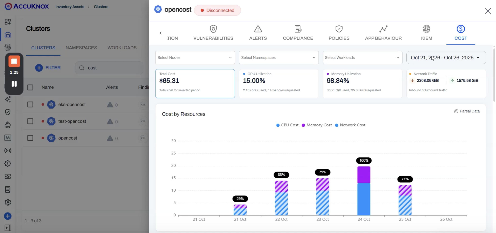

## Total Cost gives one figure for the cluster and period

The **Total Cost** card shows the cost of the cluster for the date range you set. The `opencost` cluster in the screenshots cost $65.31 for 21 to 26 October 2026. "Total cost for selected period", confirms the card follows the date range and the filters.

## Cost by Resources splits the spend into CPU, memory and network

Select the **Total Cost** card to show the **Cost by Resources** chart. It draws one stacked bar per period, with a segment each for **CPU Cost**, **Memory Cost** and **Network Cost**. A short date range gets one bar per day, and a longer date range groups the days into weeks.

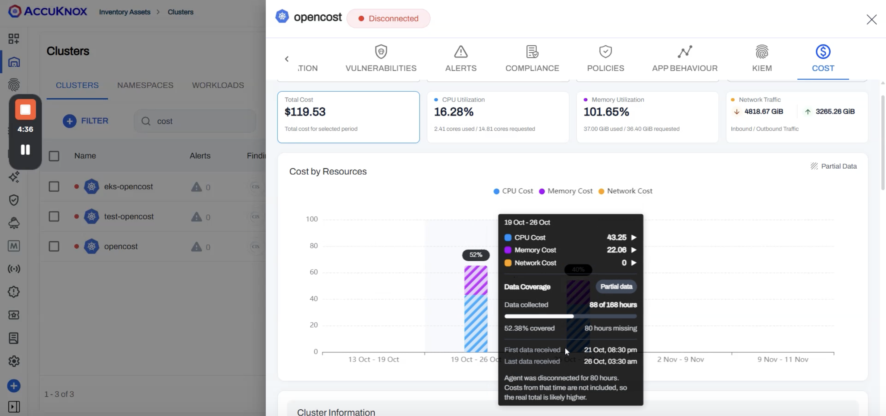
Hover over a bar for the cost of each resource in that period. For the week of 19 to 26 October the cluster shows $43.25 for CPU, $22.06 for memory and $0 for network. CPU is two thirds of the cost of that week, so CPU requests are the first place to look for savings.

## Cost tables rank every node, namespace and workload

Below the chart, a table lists the cost of each item for the period, with the highest cost first. Switch the table between **Nodes**, **Namespace** and **Workloads** to change the level. The example cluster reads as three nodes, as 53 namespaces, or as individual workloads.

In the example, `rabbitmq` is the highest-cost namespace at $25.07, followed by `accuknox-divy` at $15.37 and `weaviate` at $12.75. The table shows 10 rows per page and pages through all 53 namespaces.

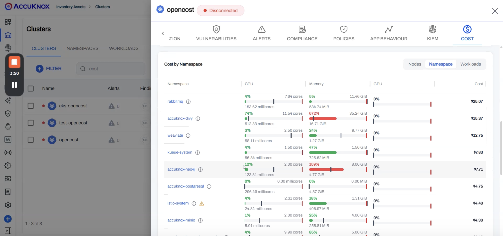

## Every row shows usage, request and limit beside the cost

Each row carries a CPU, a memory and a GPU cell. A cell puts four values on one bar, so you compare what a workload uses with what it reserved without leaving the table.

| Part of the cell | Meaning |
|---|---|
| Percentage | Efficiency, the usage average as a share of the request average |
| Value under the bar | Usage average |
| Black marker | Request average |
| Red marker and the value on the right | Limit average |

!!! note "Usage, request and limit averages"
    - **Usage average** is what the item consumed, averaged over the selected date range.
    - **Request average** is what the item asked Kubernetes to reserve, averaged over the same range. The scheduler places a pod by its request, and the kubelet reserves at least that amount for the container.
    - **Limit average** is the ceiling set for the item, averaged over the same range. The kubelet does not let a container use more than its limit.

    Kube-Cost shows averages because pods start, stop and scale during a period, so no single reading describes it. A figure for a namespace or a node covers all the workloads inside it. Kubernetes defines requests and limits in [Resource Management for Pods and Containers](https://kubernetes.io/docs/concepts/configuration/manage-resources-containers/).

For `rabbitmq`, the CPU cell reads 4%, 153.62 millicores and 7.64 cores. The namespace uses 153.62 millicores on average, which is 4% of its request, and its limit is 7.64 cores. A percentage above 100% shows in red. A row that shows 0% while its usage is above zero, such as `accuknox-postgresql` at 296.49 millicores, has no request to measure against.

## Efficiency points at oversized and under-requested workloads

Efficiency turns the cost table into a list of things to fix. A low percentage means a workload reserves far more than it uses. A percentage above 100% means the workload uses more than it reserved.

`rabbitmq` uses 4% of its CPU request and 5% of its memory request, and it is the most expensive namespace on the cluster. Kube-Cost charges a workload for the greater of its request and its usage, so `rabbitmq` pays for the request it does not use. Lowering that request lowers the cost.

`accuknox-divy` has the opposite problem. The namespace uses 672% of its memory request, 16.71 GiB against a request of about 2.5 GiB. When a node runs short of memory, the kubelet evicts pods whose usage exceeds their requests first, as the Kubernetes page on [node-pressure eviction](https://kubernetes.io/docs/concepts/scheduling-eviction/node-pressure-eviction/#pod-selection-for-kubelet-eviction) describes. Raise that memory request before you cut anything else.

## Utilization cards compare what is used with what is provisioned

Three cards beside **Total Cost** show how the cluster uses the resources it has requested.

| Card | What it shows | Example for 21 to 26 October |
|---|---|---|
| **CPU Utilization** | Cores used as a share of cores requested | 15.00%, 2.15 cores used / 14.34 cores requested |
| **Memory Utilization** | Memory used as a share of memory requested | 98.84%, 35.21 GiB used / 35.63 GiB requested |
| **Network Traffic** | Inbound and outbound traffic | 2308.05 GiB inbound, 1575.58 GiB outbound |

The example cluster requests more than six times the CPU it uses, while memory use sits level with the requests. Utilization is measured against requests, so it can pass 100%. Over the wider date range, **Memory Utilization** reads 101.65%, which is 37.00 GiB used against 36.40 GiB requested.

## Trend charts show CPU, memory and network over time

Select a utilization card to replace the cost chart with the trend for that resource. A trend shows whether a figure on a card is steady or the average of a spike.

| Card selected | Chart |
|---|---|
| **CPU Utilization** | **CPU Utilization Trend** |
| **Memory Utilization** | **Memory Utilization Trend** |
| **Network Traffic** | **Network Traffic Over Time**, split into ingress and egress in GiB |

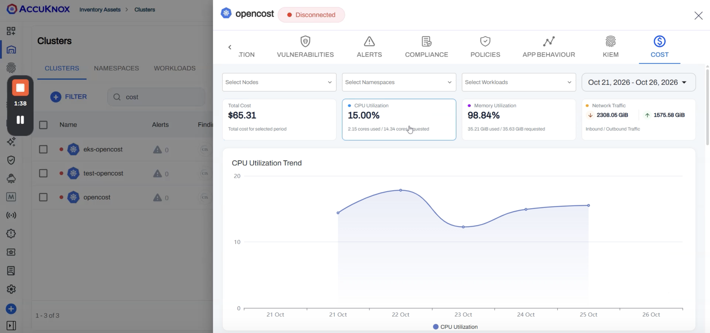

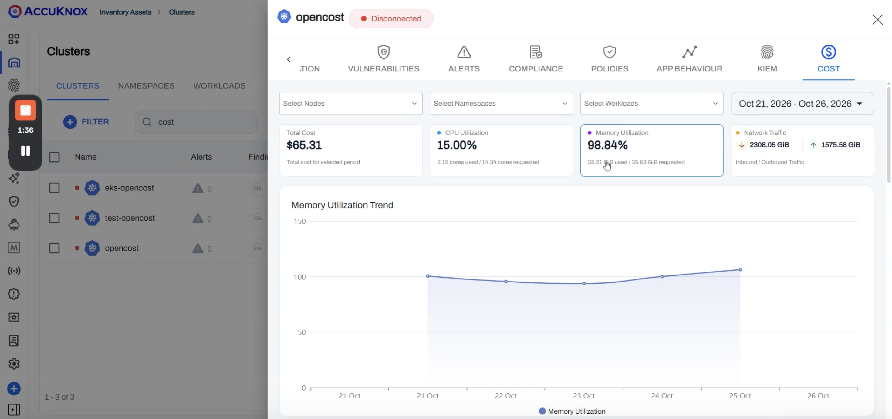

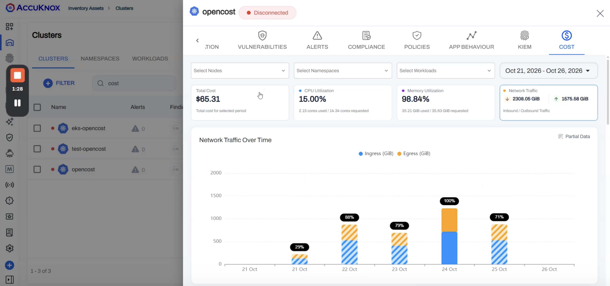

## Filters narrow the tab to a node, a namespace or a workload

**Select Nodes**, **Select Namespaces** and **Select Workloads** limit the tab to the items you pick. Each filter has a search box, checkboxes for more than one item, and **All** and **Selected** views of the list. The cards and the chart recalculate for the selection.

Selecting `kube-system` in **Select Namespaces** for 21 to 26 October drops **Total Cost** from $65.31 to $0.58. CPU, memory and network figures change with it, so you read the cost and the usage of one namespace together.

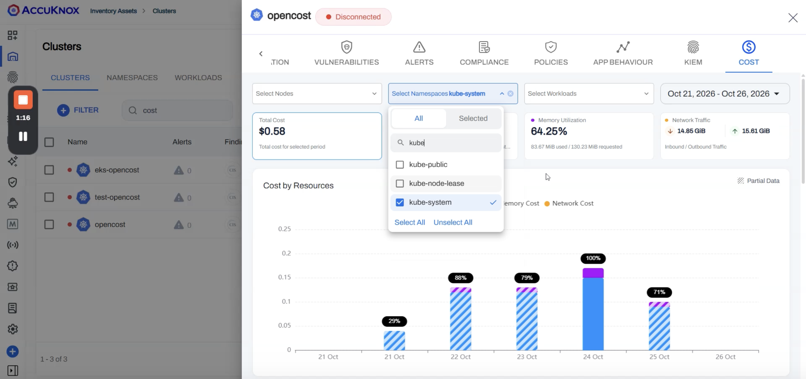

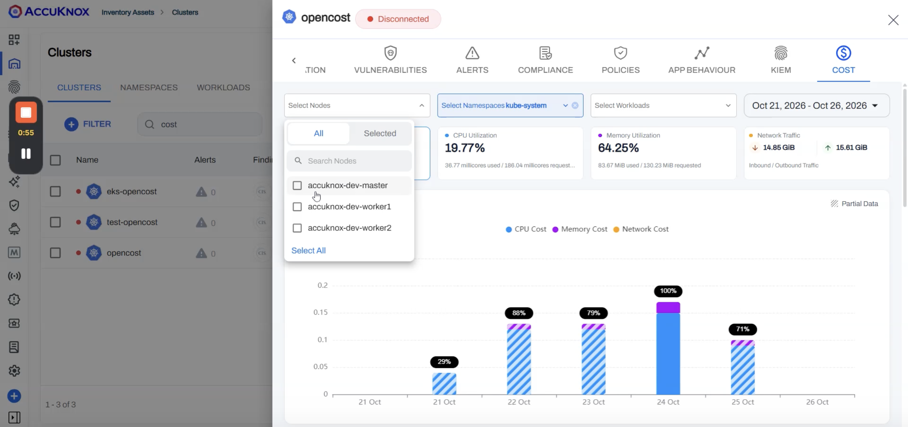

## Idle cost shows the capacity no workload was charged for

In **Cost by Nodes**, the **Include Idle Cost** toggle adds an `__idle__` row to the table. OpenCost defines cluster idle cost as "the portion of Resource Allocation Costs that are not allocated to any workload". In the example, `__idle__` is $40.70, more than the cost of either worker node at $21.18 and $19.06.

Turn the toggle on when the question is what the cluster costs to run. Turn the toggle off when you compare nodes with each other, because idle cost belongs to none of them. [Confirm whether the **Total Cost** card includes idle cost when the toggle is off, and how shared costs are distributed.]

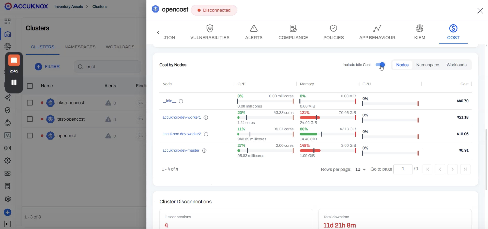

## Data coverage shows how many hours stand behind each number

Kube-Cost counts only the hours in which the cluster agent was connected, and it shows you how many hours that was. Each bar carries a label with the share of hours in its period for which the cluster reported data. A solid bar at 100% is a complete period. A hatched bar is a partial period, and the **Partial Data** key at the top right of the chart identifies the hatched pattern.

Hover over a hatched bar to open the **Data Coverage** panel.

| Field | Example | Meaning |
|---|---|---|
| **Data collected** | 88 of 168 hours | Hours with data, out of the hours in the period |
| Covered | 52.38% covered | The same figure as a percentage |
| Missing | 80 hours missing | Hours with no data |
| **First data received** | 21 Oct, 08:30 pm | Start of the data in the period |
| **Last data received** | 26 Oct, 03:30 am | End of the data in the period |

The panel then states the consequence in one line: "Agent was disconnected for 80 hours. Costs from that time are not included, so the real total is likely higher."

!!! warning
    A partial period undercounts. Costs from the missing hours are not included, so treat the total of a partial period as a minimum. A week at 52.38% coverage is not a cheaper week.

The utilization trends carry the same panel. The memory trend for 26 October to 2 November reports 67 of 168 hours collected, 39.88% covered and 101 hours missing.

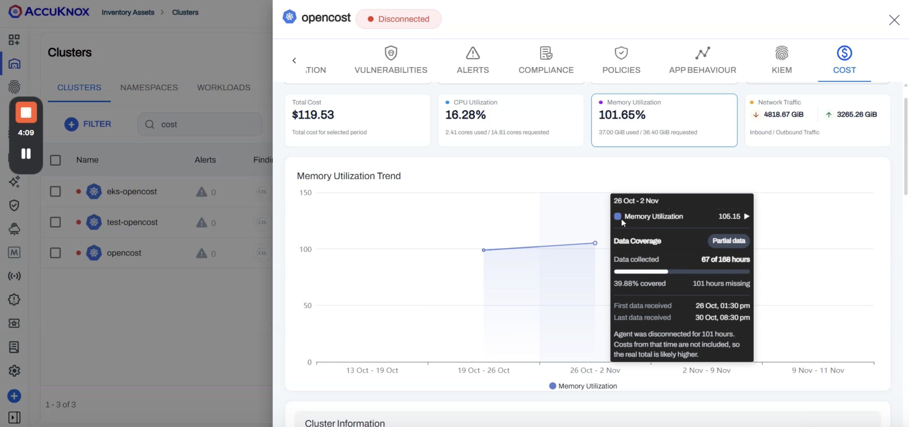

## Cluster Disconnections lists every gap in the data

**Cluster Disconnections** sits below the cost tables. Two tiles show the number of disconnections and the total downtime, 4 disconnections and 11d 21h 8m in the example. The table under the tiles gives the **Disconnected** date, the **Reconnected** date and the **Duration** of each one. A disconnection that has not ended shows **Still Disconnected**.

Match a hatched bar to the rows in this table to learn why its coverage is low. In the example, two of the four rows lasted one minute and one lasted 2h 26m. The open row, at 11d 18h 40m, accounts for almost all of the downtime. The badge beside the cluster name shows the same state, **Disconnected**, at the top of the panel.

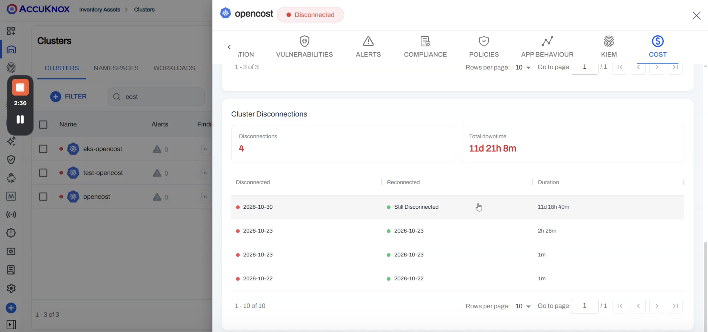

## Resource warnings flag requests and limits that do not add up

A warning icon beside a name means the request and limit figures for that row need a second look. Hover over the icon to read the reason. For `istio-system` the warning reads: "Memory request is higher than the configured limit. This is possible because some workloads have memory requests but no limit."

Set a memory limit on the workloads that have none. With a limit on every workload, the limit for the namespace is at or above its request again. [List the other resource warnings Kube-Cost raises.]

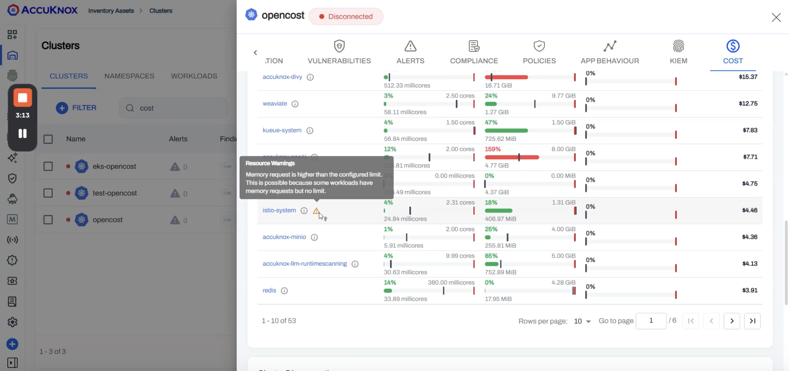

## Monthly spend and forecast answer what the month will cost

Kube-Cost reports the spend so far this month and a projected month-end cost. The projection is a run-rate forecast. It carries the spend rate observed so far in the month through to the last day, and it lists the history and the data coverage it used.

Check that coverage before you quote the projection, because disconnected hours lower the spend the forecast starts from. [Add the console location of the month-to-date and forecast view, a screenshot, and how the forecast treats a partial period.]

## Currency and custom pricing set how cost is priced and shown

Kube-Cost supports a display currency and custom pricing. Custom pricing lets you supply your own rates in place of the default ones. [Add where currency and custom pricing are set, the supported currencies, and the default price source.]

## Kube-Cost allocates cost by the rules

Kube-Cost follows the allocation model of the OpenCost specification, the open standard for Kubernetes cost allocation. Three rules from that specification explain the figures in the **COST** tab.

| Rule | What it means for your numbers |
|---|---|
| A workload is charged for the greater of its request and its usage | CPU, memory and GPU that a workload reserves and does not use still cost money |
| Network is charged by traffic volume, in and out | Network cost follows the GiB moved, with no request involved |
| Cluster idle cost is "the portion of Resource Allocation Costs that are not allocated to any workload" | The `__idle__` row is the cluster cost left over after every workload is charged |

A namespace with low efficiency can still rank first in the cost table for the first reason. The request sets the cost floor, so the saving comes from lowering the request.

## What Kube-Cost does not cover

- **Disconnected hours.** Cost and usage from hours when the agent was disconnected are not included in any total.
- **Spend outside Kubernetes.** Kube-Cost allocates cost for clusters, nodes, namespaces and workloads. [Confirm that cloud account and non-Kubernetes resource costs are out of scope for this release.]
- **Changes to your cluster.** Kube-Cost reports and warns. It does not change a request or a limit for you.

## Related

- [Cluster Onboarding](../how-to/cluster-onboarding.md)
- [Kubernetes Security Posture Management (KSPM)](kspm.md)
